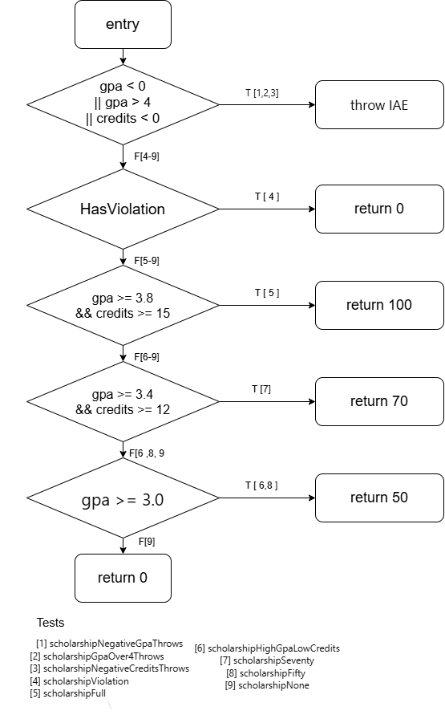

# Лаборатори №9: Код хамралт — JaCoCo-гоор тестээ хөтлөх

**Нэр:** Ц. Тодбилэг
**Оюутны код:** B232270045  
**Хичээл:** F.CSA313 — Программ хангамжийн чанарын баталгаа ба тест (2026)

## Ажлын орчин

`java -version` командын гаралт:

```text
java version "21.0.9" 2025-10-21 LTS
Java(TM) SE Runtime Environment (build 21.0.9+7-LTS-338)
Java HotSpot(TM) 64-Bit Server VM (build 21.0.9+7-LTS-338, mixed mode, sharing)
```

`mvn -version` командын гаралт:

```text
Apache Maven 3.9.12 (848fbb4bf2d427b72bdb2471c22fced7ebd9a7a1)
Maven home: C:\Program Files\apache-maven-3.9.12
Java version: 21.0.9, vendor: Oracle Corporation, runtime: C:\Program Files\Java\jdk-21
Default locale: en_US, platform encoding: UTF-8
OS name: "windows 11", version: "10.0", arch: "amd64", family: "windows"
```

Тестүүдийг ажиллуулж, хамралтын тайлан гаргах:

```bash
mvn verify
```

HTML тайлан `target/site/jacoco/index.html`, CSV тайлан `target/site/jacoco/jacoco.csv` файлд үүснэ.

## Хэсэг A: Happy path тестүүд ба эхний хэмжилт

Хэвийн урсгалын таван тест: `letterGradeA`, `letterGradeB`, `gpaTwoScores`, `scholarshipFull`, `scholarshipSeventy`. `results/mvn-verify-A.txt` файлд `Tests run: 5, Failures: 0` гэж гарсан.

`results/jacoco-A.csv`-ийн хамралт:

| Үзүүлэлт | Хамрагдсан | Хамрагдаагүй | Хамралт |
|---|---|---|---|
| Мөр (Line) | 15 | 10 | 15 / 25 = 60.0% |
| Салаа (Branch) | 21 | 20 | 21 / 41 = 51.2% |

**Ажиглалт.** Улаан (огт хүрээгүй) мөрүүд нь гурван `throw new IllegalArgumentException(...)` мөр, `letterGrade()`-ийн `"C"`, `"D"`, `"F"` буцаах мөрүүд, `gpa()`-ийн `case "C"` ба `case "D"`, мөн `scholarship()`-ийн сүүлийн хоёр буцаалт (`return 50` ба `return 0`) байв. Happy path тестүүд буруу оролт, 80-аас бага оноо, 70%-иас бага тэтгэлэг олгох тохиолдлыг огт ашиглаагүй тул хүрээгүй кодын ихэнх нь алдааны (exception) замууд байсан бөгөөд шаардлагад суурилсан тестүүд ийм кодод ховор хүрдэг. Шар ромбо (хагас хамрагдсан салаа) нь оролт шалгадаг гурван `if` дээр гарсан бөгөөд тэнд нөхцөл бүрийн зөвхөн худал утга нь ажилласан; мөн `if (score >= 80)`, `gpa()`-ийн `switch` (зөвхөн `"A"`, `"B"` салаа), `if (hasViolation)` (хэзээ ч үнэн болоогүй) болон `scholarship()`-ийн хоёр `&&` нөхцөл дээр шар ромбо гарсан (жишээ нь `credits >= 15` хэзээ ч худал болоогүй).

## Хэсэг B: `scholarship()`-ийн CFG ба 100% хамралт



`cfg.png`-г draw.io ашиглан Лекц 9-ийн хэв маягаар өөрөө зурсан: шийдвэр бүрийг ромбо (нийлмэл нөхцөл нэг ромбод багтана), үйлдэл бүрийг тэгш өнцөгт, ирмэг бүрийг T/F-ээр тэмдэглэсэн. Зураг дээрх ирмэгийн тэмдэглэгээ нь графын доорх жагсаалтын тестийн дугаарууд юм. Ижил холбоосыг тестийн бүтэн нэрээр нь доорх хүснэгтэд үзүүлэв:

| Шийдвэр | Ирмэг | Хүрэх зангилаа | Ирмэгийг дайрч буй тестүүд |
|---|---|---|---|
| `gpa < 0 \|\| gpa > 4 \|\| credits < 0` | T | `throw IllegalArgumentException` | `scholarshipNegativeGpaThrows`, `scholarshipGpaOver4Throws`, `scholarshipNegativeCreditsThrows` |
| | F | `hasViolation` | `scholarshipViolation`, `scholarshipFull`, `scholarshipHighGpaLowCredits`, `scholarshipSeventy`, `scholarshipFifty`, `scholarshipNone` |
| `hasViolation` | T | `return 0` | `scholarshipViolation` |
| | F | `gpa >= 3.8 && credits >= 15` | `scholarshipFull`, `scholarshipHighGpaLowCredits`, `scholarshipSeventy`, `scholarshipFifty`, `scholarshipNone` |
| `gpa >= 3.8 && credits >= 15` | T | `return 100` | `scholarshipFull` |
| | F | `gpa >= 3.4 && credits >= 12` | `scholarshipHighGpaLowCredits`, `scholarshipSeventy`, `scholarshipFifty`, `scholarshipNone` |
| `gpa >= 3.4 && credits >= 12` | T | `return 70` | `scholarshipSeventy` |
| | F | `gpa >= 3.0` | `scholarshipHighGpaLowCredits`, `scholarshipFifty`, `scholarshipNone` |
| `gpa >= 3.0` | T | `return 50` | `scholarshipHighGpaLowCredits`, `scholarshipFifty` |
| | F | `return 0` | `scholarshipNone` |

**CFG-д 10 ирмэг байхад JaCoCo яагаад илүү олон салаа тоолдог вэ?** CFG-д 5 шийдвэр, 10 ирмэг бий, харин JaCoCo `||` ба `&&` доторх нөхцөл бүрийг тусдаа салаа гэж тоолдог тул `scholarship()`-ийн 9 нөхцөл 18 салаа болдог. Иймээс эхний `if`-д гурван тусдаа `assertThrows` тест хэрэгтэй: үнэлгээ эхний үнэн нөхцөл дээр зогсдог (short-circuit) тул нэг тест `gpa < 0`, `gpa > 4`, `credits < 0` гурвын зөвхөн нэгийг нь үнэн болгож чадна. Мөн `scholarshipHighGpaLowCredits` тест хэрэгтэй байсан, учир нь энэ бол `&&`-ийн голчийн хэсэг үнэн, кредитийн хэсэг худал болдог цорын ганц тест юм (голч хангасан ч кредит дутуу).

Хэсэг B-д нэмсэн тестүүд (15): `letterGradeC`, `letterGradeD`, `letterGradeF`, `letterGradeNegativeThrows`, `letterGradeOver100Throws`, `gpaAllGrades`, `gpaNullThrows`, `gpaEmptyThrows`, `scholarshipNegativeGpaThrows`, `scholarshipGpaOver4Throws`, `scholarshipNegativeCreditsThrows`, `scholarshipViolation`, `scholarshipHighGpaLowCredits`, `scholarshipFifty`, `scholarshipNone`. Exception-ы замуудад `assertThrows` ашигласан.

**Үр дүн.** Нийт 20 тест шаардагдсан (Хэсэг A-гийн 5 ба шинэ 15) бөгөөд энэ нь `results/mvn-verify-B.txt`-ийн `Tests run: 20, Failures: 0`-тэй таарч байна. `results/jacoco-B.csv`-д **BRANCH_MISSED = 0** (41 хамрагдсан), **LINE_MISSED = 0** (25 хамрагдсан) буюу салаа ба мөрийн хамралт хоёул 100%.

## Хэсэг C: `gpa()`-ийн давталтын заагийн тестүүд

| Давталт | Тест | Оролт | Хүлээгдэж буй үр дүн |
|---|---|---|---|
| 0 удаа | `gpaEmptyThrows` | `new double[]{}` | `IllegalArgumentException` |
| 0 удаа | `gpaNullThrows` | `null` | `IllegalArgumentException` |
| 1 удаа | `gpaLoopOneIteration` | `{95}` | `4.0` |
| 2+ удаа | `gpaLoopManyIterations` | `{95, 85, 75, 65}` | `2.5` |

`gpaEmptyThrows`, `gpaNullThrows` тестүүдийг Хэсэг B-д, `gpaLoopOneIteration`, `gpaLoopManyIterations` тестүүдийг Хэсэг C-д нэмсэн.

Эдгээр тест хамралтыг өсгөөгүй, учир нь Хэсэг B-гийн дараа хамралт аль хэдийн 100% байсан бөгөөд `gpaTwoScores`, `gpaAllGrades` тестүүд давталтын бие болон давталтаас гарах замыг өмнө нь ажиллуулсан. Гэсэн ч эдгээр тест хэрэгтэй хэвээр, учир нь хамралт давталтын хэсэг бүр дор хаяж нэг удаа ажилласныг л бүртгэдэг бол 0/1/2+ тестүүд давталтын үр дүнг зааг дээр нь шалгадаг бөгөөд `total`-ын анхны утга буруу байх, буруу тоонд хуваах зэрэг алдаа яг эдгээр зааг дээр илэрдэг.

## Хэсэг D: Хамралт 100% — гэхдээ алдаа амьд

Спецификациас авсан зааг утгын тестүүд:

| Тест | Оролт | Хүлээгдэж буй | Засварын өмнө |
|---|---|---|---|
| `letterGradeBoundary60IsD` | 60 | `"D"` | **унасан** |
| `letterGradeBoundary5999IsF` | 59.99 | `"F"` | амжилттай |
| `letterGradeBoundary6999IsD` | 69.99 | `"D"` | амжилттай |
| `letterGradeBoundary0IsF` | 0 | `"F"` | амжилттай |
| `letterGradeBoundary100IsA` | 100 | `"A"` | амжилттай |
| `letterGradeBoundary8999IsB` | 89.99 | `"B"` | амжилттай |
| `letterGradeBoundary90IsA` | 90 | `"A"` | амжилттай |

Засварын өмнө `mvn test` ажиллуулахад (`results/mvn-test-D-fail.txt`) `Tests run: 29, Failures: 1` ба BUILD FAILURE гарсан. Унасан тест:

```text
[ERROR]   ScholarshipCalculatorTest.letterGradeBoundary60IsD:37 expected: <D> but was: <F>
```

**Алдаа.** Спецификацид 60-69.99 оноо `"D"` гэж заасан ч `letterGrade()` хатуу харьцуулалт ашиглаж байсан:

```java
if (score > 60)  return "D";
```

60-ын хувьд `60 > 60` худал тул оноо `return "F"` руу шилжиж байв. Засвар нь 60-ыг хамруулсан:

```java
if (score >= 60)  return "D";
```

Засварыг тусдаа commit-оор хийсэн: `916d4bd` ("Fix letterGrade"). Унасан тестүүдийг түүнээс өмнө `945bffc` ("Part D: boundary tests") commit-д оруулсан.

**Засварын дараа.** `results/mvn-verify-final.txt`-д `Tests run: 29, Failures: 0, Errors: 0, Skipped: 0` ба BUILD SUCCESS гарсан (Хэсэг B-гийн 20, Хэсэг C-гийн 2, Хэсэг D-гийн 7 тест). `results/jacoco-final.csv`-д **BRANCH_MISSED = 0**, **LINE_MISSED = 0**.

### Гол дүгнэлт

Хэсэг B-гийн дараа салаа ба мөрийн хамралт аль хэдийн 100% байсан (`results/jacoco-B.csv`) ч `letterGrade(60)` нь `"D"`-ийн оронд `"F"` буцааж байв. Энэ алдаа хамралтад "үл үзэгдэгч" байсан шалтгаан нь `score > 60` ба `score >= 60` хоёул яг ижил хоёр салаа үүсгэдэгт оршино: аль ч оператортой үед `letterGradeD` (65) үнэн салаагаар, `letterGradeF` (50) худал салаагаар явдаг тул алдаатай кодын `jacoco-B.csv`, зассан кодын `jacoco-final.csv` хоёул BRANCH_MISSED = 0, LINE_MISSED = 0 гэж харуулдаг. Хоёр хувилбар зөвхөн 60 гэсэн ганц оролт дээр өөрөөр ажилладаг тул спецификацийн заагаас сонгосон `letterGradeBoundary60IsD` тест л алдааг илрүүлж чадсан. Хамралт нь аль мөр, аль салаа ажилласныг хэмждэг болохоос тэдгээрийн гаргасан үр дүн зөв эсэхийг хэмждэггүй: хамралтад oracle байхгүй, спецификацийг мэддэггүй. Тиймээс хамралт нь тестлэгдээгүй кодыг олоход зайлшгүй хэрэгтэй (Хэсэг A шиг) боловч кодыг зөв гэж батлах хангалттай нотолгоо болж чадахгүй.

## Үр дүнгийн файлууд

| Файл | Агуулга |
|---|---|
| `results/mvn-verify-A.txt` | Хэсэг A-гийн дараах `mvn verify` гаралт (5 тест) |
| `results/jacoco-A.csv` | Хэсэг A-гийн дараах хамралт |
| `results/mvn-verify-B.txt` | Хэсэг B-гийн дараах `mvn verify` гаралт (20 тест) |
| `results/jacoco-B.csv` | Хэсэг B-гийн дараах хамралт (BRANCH_MISSED = 0, LINE_MISSED = 0) |
| `results/mvn-test-D-fail.txt` | Засварын өмнөх `mvn test` гаралт (29 тест, 1 унасан) |
| `results/mvn-verify-final.txt` | Засварын дараах `mvn verify` гаралт (29 тест, 0 унасан) |
| `results/jacoco-final.csv` | Засварын дараах хамралт (BRANCH_MISSED = 0, LINE_MISSED = 0) |

## AI туслах ашигласан байдал

Энэ ажилд AI туслахыг (Claude Code дахь Claude) дараах зүйлд ашигласан: даалгаврыг тайлбарлах, Maven ба Git-ийн алдааг засах, тестийн кодыг санал болгох (Хэсэг A–D), жишээ CFG зурах, `> 60` алдааг эрт олж хэлэх, README-ийн ноорог бичих. `cfg.png`-г би draw.io дээр өөрөө зурж, бүх тестийг өөрийн машин дээр ажиллуулан `results/` файлуудыг гаргасан бөгөөд README-ийн тоо бүрийг `results/` файлуудтай тулгаж шалгасан.
